# decky-proton-launch

<p align="center">
  <a href="https://discord.gg/yWXXAC2AKc"></a>
</p>


**Manage Proton launch options easily on your Steam Deck via Decky Loader.**

Decky Proton Launch provides a simple, intuitive interface to enable commonly used Proton environment variables for your Steam games. Select one or multiple options, copy the wrapper command, or configure per-game profiles directly from the plugin.

### ✨ New in 0.17.0

- Apply a variable to several games at once from the Options button, with a live progress card
- Command groups: create a group from pasted launch options, apply it to chosen games (with “VR” and “VR only” filters to tick matching games in one tap), then edit it to update all of them at once
- Automatic filter for groups (e.g. VR games): newly installed matching games get the group automatically, can be turned off in Settings
- “Clean launch options” button: removes from Steam launch options what the plugin already applies, with a before/after preview and undo
- Tab navigation, on by default and optional in Settings: switch pages with the controller's shoulder buttons from anywhere

---

## Screenshots

### Games list

Your Steam library, grouped by configuration status — Ready, Wrapper only, Commands only, Not configured — with a search bar to quickly find a game.

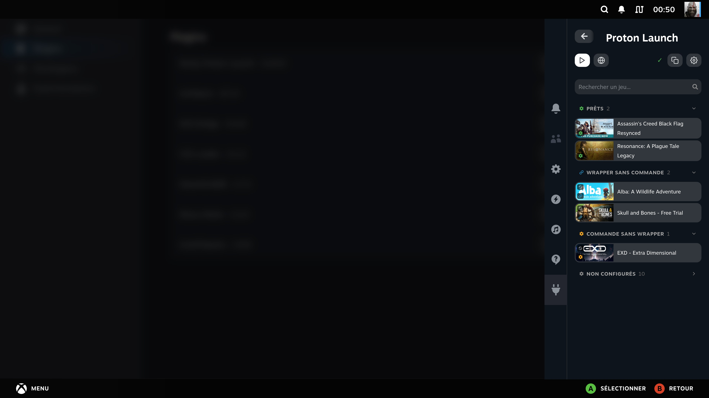

### Per-game configuration

Click on any game to open its profile and configure launch options individually. Changes apply on next game launch.

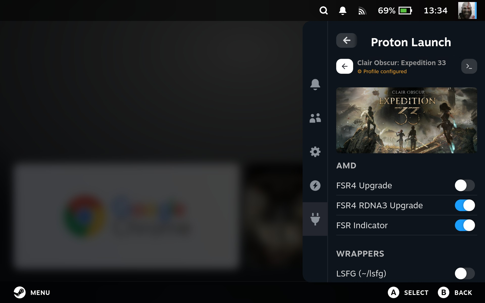

When an option is enabled, you can instantly switch its value between **Enable** and **Disable** directly from the game profile.

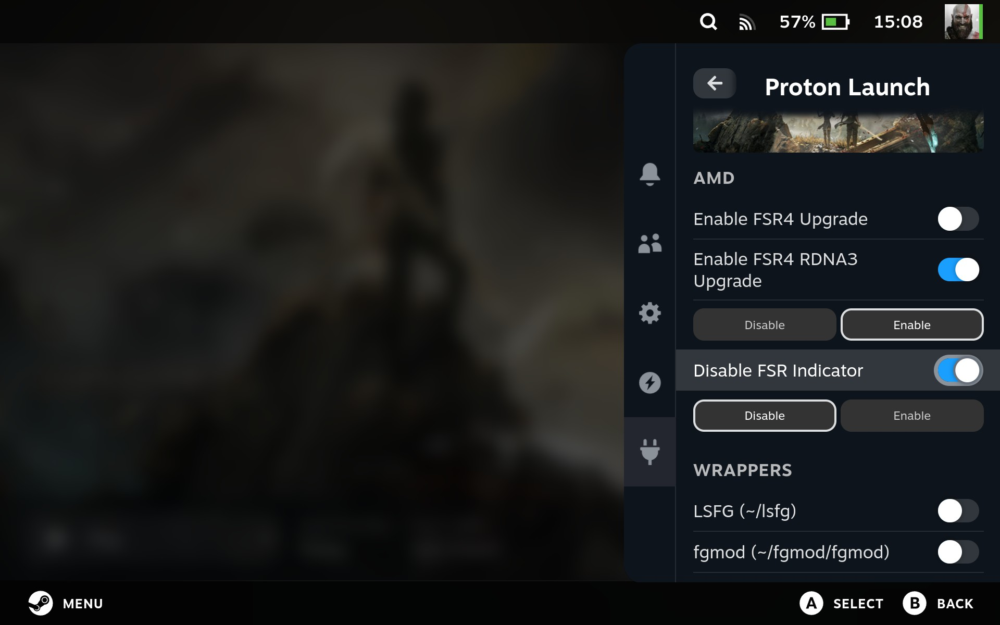

### Global commands

Set commands once from the globe icon in the top bar and they apply to every game that has the wrapper installed — no need to configure each game individually. Add your own custom variables or wrappers directly from this page.

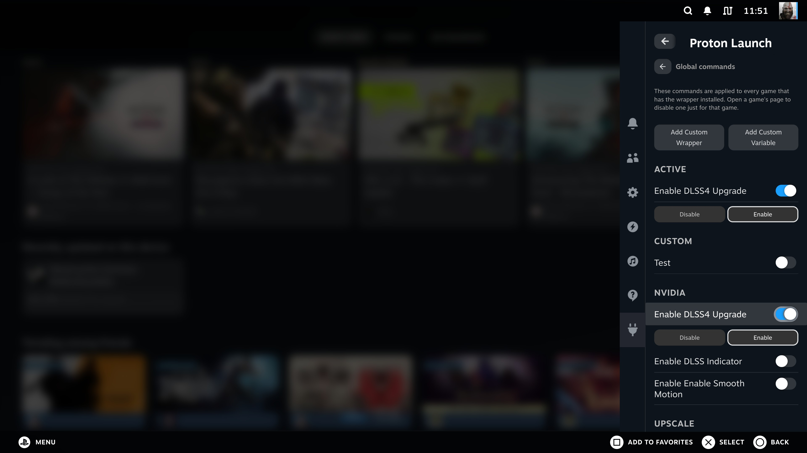

Open any game's page to disable a specific globally-enabled command just for that game, without touching the global setting. The **Active** section at the top always shows everything currently enabled, including which ones come from global commands, without having to scroll through every category.

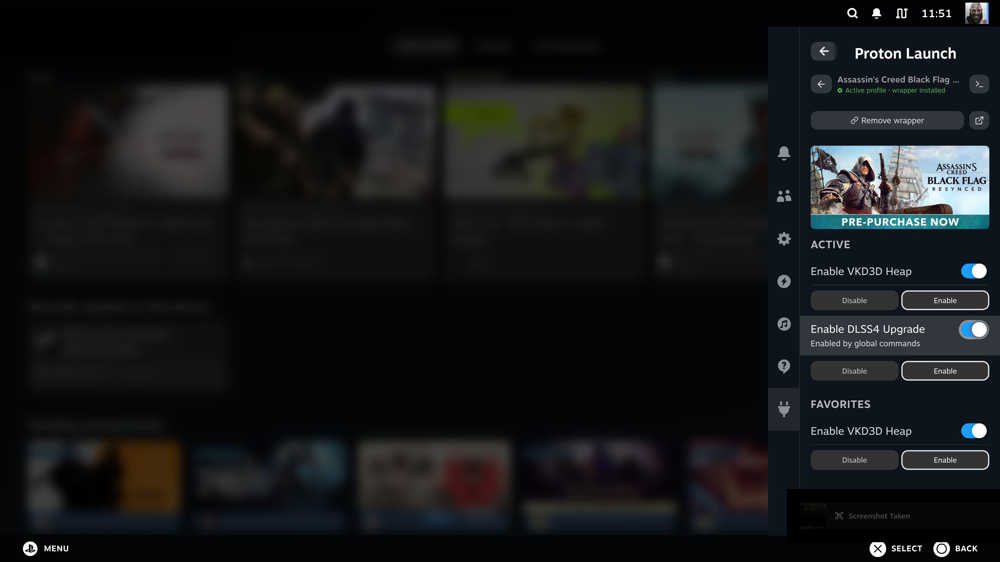

### Command groups

A group is a set of variables created once — by pasting launch options such as `VAR=1 OTHER=/path %command%` — then applied to the games of your choice. Editing the group updates every game using it. A group can also follow an automatic filter (e.g. VR games), so matching games are added when they are installed; this can be turned off in Settings.

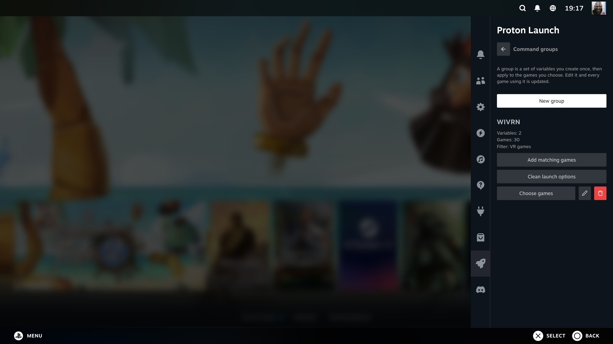

Choosing the games shows which ones already have the group, with "VR" and "VR only" filters to tick matching games in one tap. A "Clean launch options" button removes from Steam's launch options what the plugin already applies, with a before/after preview and undo.

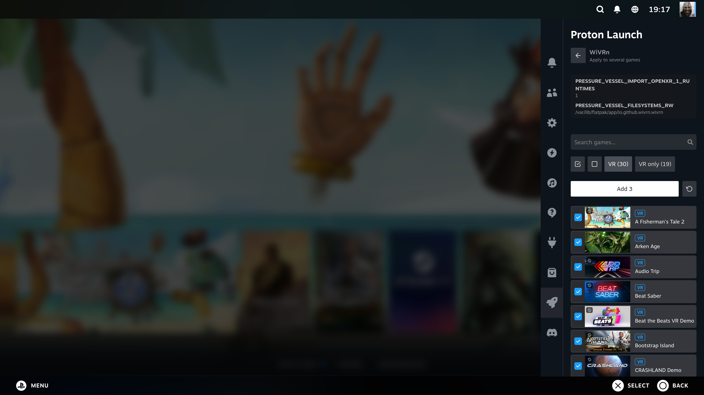

### Running game detection

The plugin automatically detects the currently running game and shows it at the top — click it to jump directly to its settings.

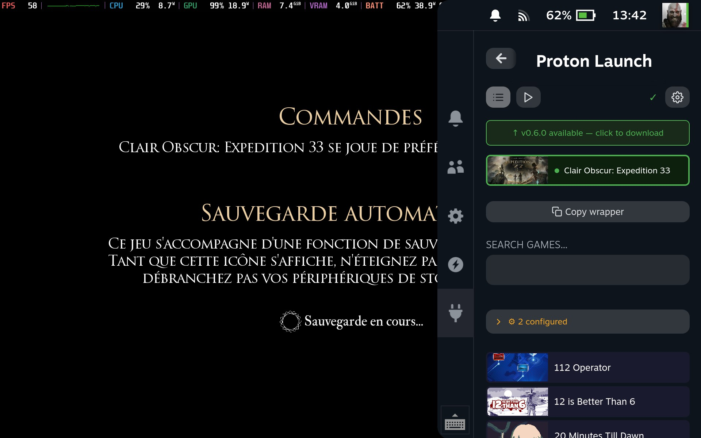

### Tab navigation

Pages are shown as icon tabs — variables, games, global commands, command groups, settings. The controller's shoulder buttons switch page from anywhere (the labels follow the controller in use: LB / RB on Xbox, L1 / R1 on PlayStation and Steam, L / R on Switch), and the icons stay clickable with a mouse or touch. On by default; can be turned off in Settings.

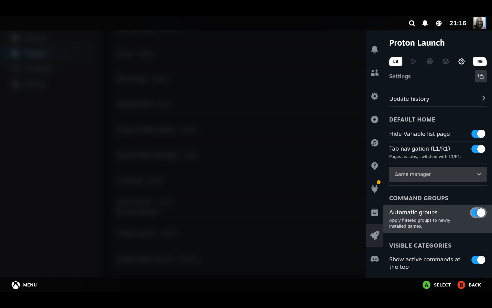

### Settings

The settings view lets you choose the default home tab (variable list, game manager, or global commands) and toggle the visibility of each variable category to keep only what's relevant to you.

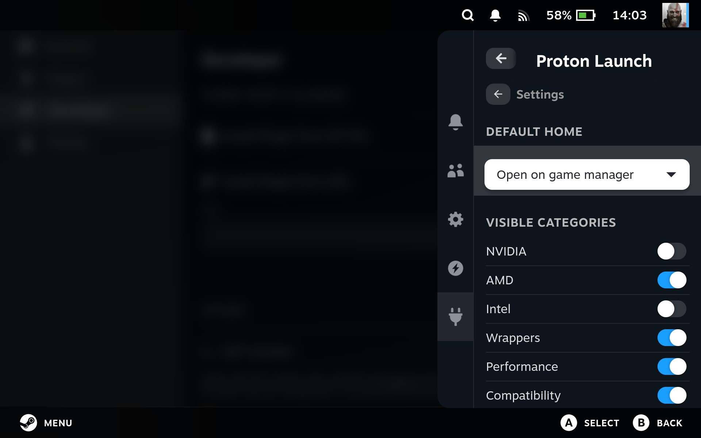

You can also check for plugin updates, install any past release from a version picker, force-refresh the variable data, or reset your custom wrappers/commands from here.

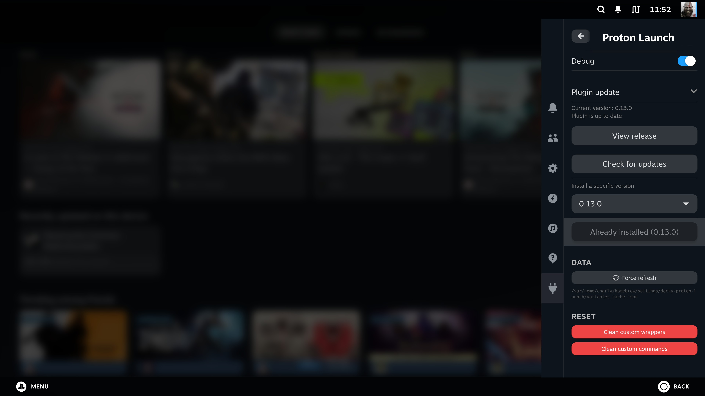

### Update notifications

When a new version is available, a banner appears at the top with a direct link to download it. Past updates are also viewable at any time from the update history section.

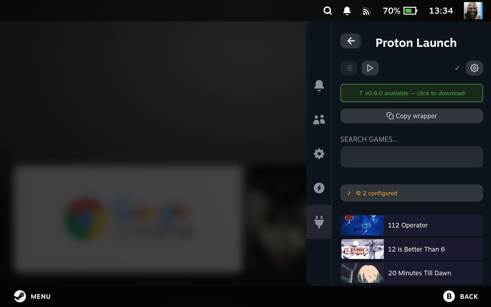
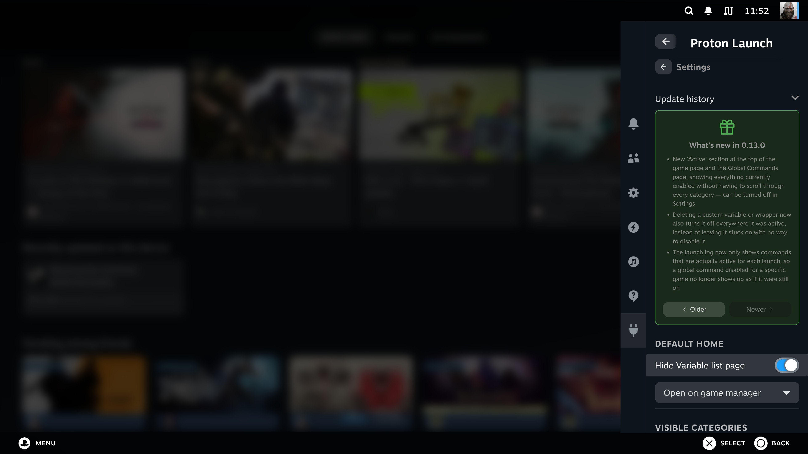

### Variable list & selection

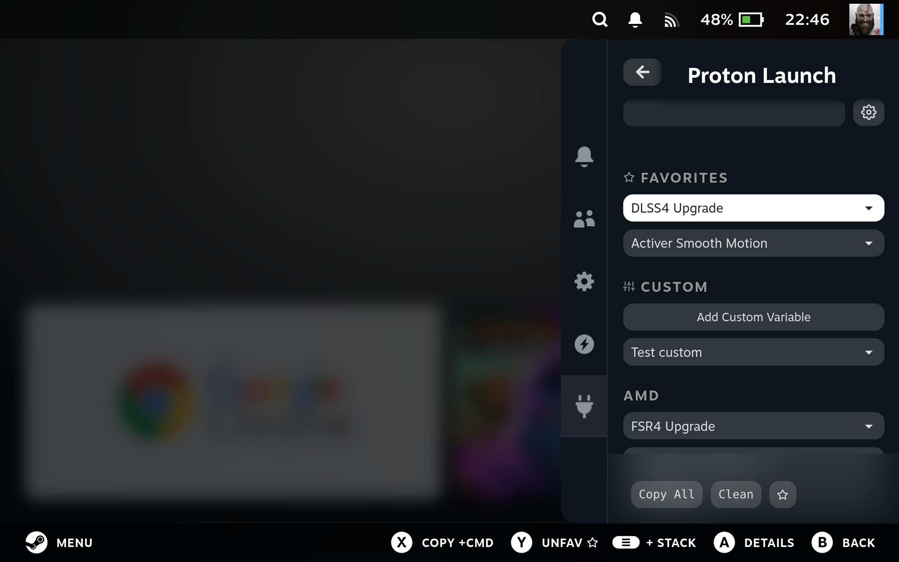
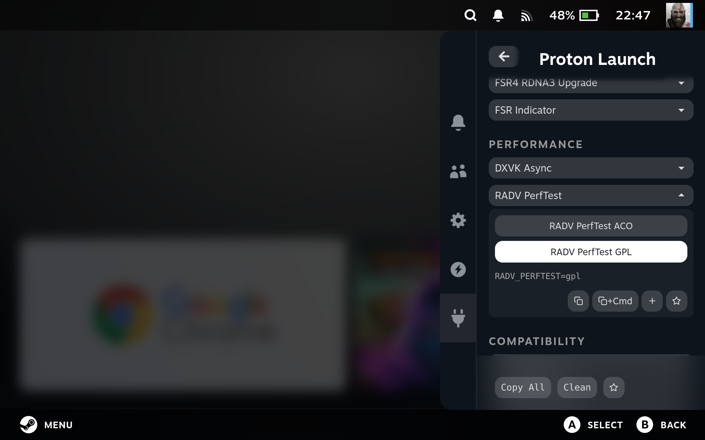

---

## Features

- **Predefined Proton variables**: FSR4, DLSS4, XeSS, DXVK Async, ESYNC/FSYNC, MangoHud, and more
- **Global commands**: enable commands once for every game with the wrapper, with per-game override to disable one individually
- **Command groups**: apply a set of variables to several games at once, with VR filters and automatic application to newly installed games
- **Per-game profiles**: configure and save launch options per game
- **Favorites with full controls**: pinned commands keep their enable/disable toggle and enum value picker, right at the top
- **Running game detection**: instantly jump to the settings of the game you're playing
- **Wrapper script**: copy the `~/proton-launch %command%` wrapper or install it with one click
- **Category visibility**: show or hide variable categories from the settings view
- **Update notifications**: banner shown when a newer version is available on GitHub
- **Gamepad navigation**: fully accessible with the Steam Deck controller, with tab navigation using the controller's shoulder buttons (can be turned off in Settings)
- **Multi-language support**: EN, FR, DE, ES, IT, PT-BR, PT-PT, RU, PL, NL, TR, UK, JA, KO, ZH-CN

---

## Installation

Download the latest release zip from the [Releases page](https://github.com/moi952/decky-proton-launch/releases/latest) and load it via Decky Loader, or build from source:

1. Clone the repository:

```bash
git clone https://github.com/moi952/decky-proton-launch.git
```

2. Install dependencies:

```bash
sudo npm install -g pnpm@9
pnpm install
```

3. Build the plugin:

```bash
pnpm run build
```

4. Load the plugin via Decky Loader.

---

## Contributing

Contributions are welcome!

- **New language**: add a JSON file in `src/i18n/locales/` following the existing structure and open a PR.
- **New Proton variable**: propose it via an issue or a PR in the
[decky-proton-launch-data](https://github.com/moi952/decky-proton-launch-data) repository.

---

## License

BSD-3-Clause License
